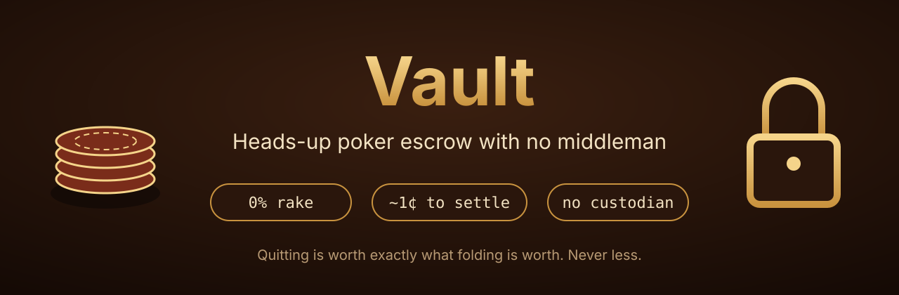
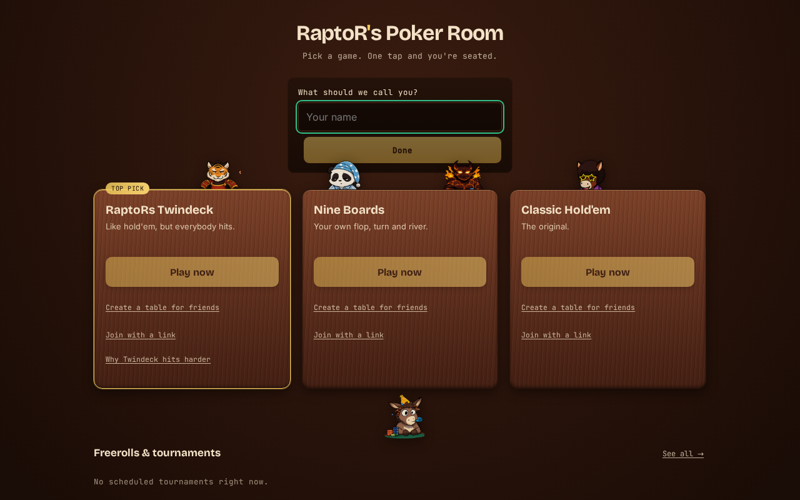
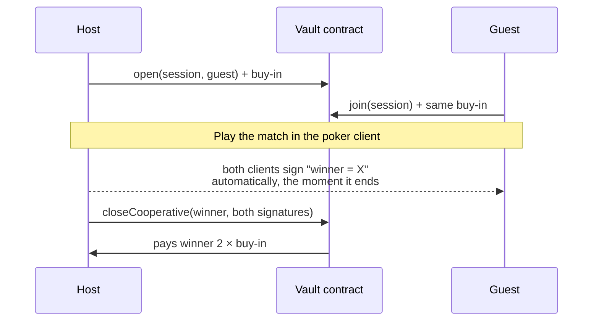

<p align="center">
  
</p>

<p align="center">
  <a href="LICENSE"></a>
  
  
  
</p>

# Vault

**A smart contract that holds two players' buy-ins for a heads-up match and
pays the winner. No poker site, no escrow agent and no Vault server ever
touches the money, and none of them takes a cut.**

Online poker asks you to trust a site with your bankroll and pay it rake on
every pot. Playing a private match for money asks you to trust your opponent
to pay up. Vault removes both:

- **0% rake, provably.** The contract has no fee code. The winner receives
  exactly `buyIn * 2` ([`Channel.sol`](contracts/src/Channel.sol)). You
  can check that line yourself.
- **No custodian.** The buy-ins sit in a public contract until the match
  ends. Nobody can freeze, seize or "process" a withdrawal.
- **Rage-quitting can't save you.** Disconnecting while behind costs exactly
  what folding costs. See [The disconnect problem](#the-disconnect-problem).

> **Play it:** Vault plugs into **[RaptoR's Poker Room at vibegto.com](https://vibegto.com)**,
> a free poker site with heads-up play and provably fair cards. It runs on a
> test network with play money. New to crypto wallets? The
> **[step-by-step player guide](https://buyin.vibegto.com/guide.html)** takes
> about ten minutes.

<p align="center">
  <a href="https://vibegto.com"></a>
</p>

---

## What it costs, compared to rake

A poker room's fee grows with the stakes. Vault's doesn't: it's the network's
transaction fee, the same whether you play for $10 or $10,000.

**Heads-up sit & go: fees vs. Vault, per 1,000 matches.** Tournament fees at
major sites run 5–15% of the buy-in, and PokerStars' sit & go scale slides
from 8% at the bottom to 5% at the top.<sup>[1][2]</sup> The table uses 5%,
the low end. Some heads-up formats are discounted below that.

| Buy-in | Room fee per player, per match | Per 1,000 matches | Vault, per 1,000 matches |
|---:|---:|---:|---:|
| $50 | $2.50 | **$2,500** | ~$10 |
| $100 | $5.00 | **$5,000** | ~$10 |
| $500 | $25.00 | **$25,000** | ~$10 |
| $1,000 | $50.00 | **$50,000** | ~$10 |

The Vault column is the whole match, shared by both players.

**Heads-up cash games** (Vault V2, built and not yet deployed): every major
site rakes 5% of each pot, with heads-up caps of $0.50–$3.00 per pot.<sup>[1]</sup>
At a $2 cap, 1,000 capped pots cost $2,000. On Vault, each hand settles with
one small transaction, a fraction of a cent.

<details>
<summary><b>How the Vault number is worked out</b></summary>

A full V1 match is three transactions: host deposits, guest deposits, and
one cooperative close carrying both signatures. Together they use about
**250,000 gas**, estimated from the contract's own test measurements in
[`contracts/.gas-snapshot`](contracts/.gas-snapshot) plus the network's fixed
per-transaction cost.

On Base mainnet, measured 2026-10-24: gas price **0.006 gwei**, ETH **$2,334**.

```
250,000 gas × 0.006 gwei = 0.0000015 ETH ≈ $0.0035
+ Base's L1 data fee for three small transactions
≈ about 1 cent per match
```

Even a tenfold fee spike keeps a match under 10 cents. V2's per-hand
transaction measured 61,740–109,676 gas, under half a cent at the same
prices.

Rakeback and VIP programs return part of a room's rake to regulars, so a
pro's *net* rake is lower than the room column shows. Even at 50%
rakeback, $500 heads-up sit & gos cost $12,500 per 1,000 matches, against
about $10 on Vault.

</details>

---

## How a match works



1. **Open.** The host locks a buy-in and names the opponent's wallet.
2. **Join.** The opponent locks the same amount. Until then the host can
   cancel and take the deposit back.
3. **Play.** The match happens in the poker client. The deck is fixed by the
   shuffle before any card is dealt.
4. **Close.** The instant the match ends, both clients sign the result
   without a click. Either player submits both signatures and the contract
   pays the winner. No one's approval is needed beyond the two players.

Your wallet key and the poker client's card key never share a page, a
process or a lifetime. Vault runs as its own small app for exactly that
reason.

## The disconnect problem

The hard part of trustless poker isn't paying the winner. It's the loser who
closes the tab and never signs. Vault's rule: **quitting is worth exactly
what folding is worth.**

If your opponent goes silent:

1. You **claim by default** and post a bond of 10% of the buy-in.
2. They have a window (30 minutes by default) to answer **"I'm here."** If
   they do, your claim was false and they keep your bond.
3. Answering isn't enough. After "I'm here," the match still has to close
   with both signatures. If it never does, the original claimant wins.

So a player who is losing gains nothing by vanishing, and a player who makes
a false claim pays for it.

**Known limitation, stated plainly:** the contract alone can't tell "the
loser is stalling" from "the winner stepped away for a minute." The
automatic signing at match end is the mitigation: in an honest game, a
signed result exists before the dispute path is ever needed. A modified
client that refuses to sign could still try this, and the risk is limited to
that match's buy-in. The full reasoning is in [OVERVIEW.md](OVERVIEW.md).

## Status

| Part | State |
|---|---|
| **V1: heads-up sit & go** | Live on Base Sepolia (testnet) at [`0xF41A…81f6`](https://sepolia.basescan.org/address/0xF41A685C7e260397Be07cC75008D29A7457481f6). Deposits verified end to end with two real wallets. 26 adversarial tests. |
| **V2: heads-up cash games** | Built, with per-hand settlement and on-chain evidence for disputes (card reveals, hand evaluation, betting replay). The design went through sixteen independent adversarial reviews. Not yet deployed. |
| **Audit** | Not audited yet. |
| **Mainnet** | Not deployed. Testnet and play money only. |

The contract suite is 144 tests across V1 and V2. Every attack found during
design review, and how it was closed, is written up in
[`docs/superpowers/`](docs/superpowers/).

## Run it yourself

You need Node.js and, for the contracts, [Foundry](https://book.getfoundry.sh/).

```bash
# Contract tests
cd contracts && forge test

# The Vault app (serves on http://localhost:8790)
npm install
npm run build
npm start
```

Vault opens from a poker client's **Buy-in** button with
`?session=<id>&seat=<host|guest>` in the address, so on its own it shows a
"open this from the poker client" notice. To deploy your own copy of the
contract to Base Sepolia, see [`contracts/.env.example`](contracts/.env.example).
The deploy script refuses any network other than Base Sepolia or a local test
chain.

**This repository ships configured for test networks only, and the public
deployment above uses play money only.** If you fork it and point it at a
network with real value, you're running your own deployment: its security,
its legality where you are, and any funds in it are entirely your
responsibility. See the [disclaimer](#disclaimer-use-at-your-own-risk).

## What's in here

| Path | What |
|---|---|
| [`contracts/src/Channel.sol`](contracts/src/Channel.sol) | V1 escrow: open, join, cooperative close, disputes. About 190 lines. |
| [`contracts/src/ChannelV2.sol`](contracts/src/ChannelV2.sol) | V2 cash-game settlement and dispute engine. |
| `contracts/src/Dleq.sol`, `Ristretto.sol`, `Evaluator7.sol`, `BettingReplay.sol`, `Evidence.sol` | On-chain proof checks used only in disputes: card reveals, 7-card hand ranking, betting-rule replay. |
| [`src/`](src/) | The Vault web app: connect wallet, open or join, follow the match, close. |
| [`VISION.md`](VISION.md) | Why this exists. |
| [`OVERVIEW.md`](OVERVIEW.md) | How it fits together, and the design reasoning. |
| [`docs/superpowers/`](docs/superpowers/) | Full design specs, review findings and build plans. |

## Disclaimer: use at your own risk

**Vault is experimental software provided as is, with no warranty of any
kind. It has not been audited. You use it entirely at your own risk. The
author and contributors are not responsible for any lost funds, failed or
stuck transactions, bugs, wallet mistakes, network fees, or any other loss
or damage, however it happens.** Smart contracts can't be patched once
deployed, and blockchain transactions can't be reversed. Never put in more
than you can afford to lose. The full legal terms are in the [MIT
license](LICENSE).

## Legal

Vault is software. It doesn't run games, match players, hold funds or take
fees. Whether playing for real money is legal depends on where you live, and
in many places it isn't without a licensed operator. Check your local law.
Nothing here is legal advice. The public deployment runs on a test network
with play money only.

## License

[MIT](LICENSE). Use it, fork it, build on it.

---

<sub>[1] <a href="https://www.deucescracked.com/poker/rake-comparison">DeucesCracked rake comparison</a>,
updated October 2026: 5% cash rake at every site listed, heads-up caps $0.50–$3.00,
tournament fees 5–15% of the buy-in.
[2] <a href="https://www.techloy.com/ggpoker-vs-pokerstars-comparing-player-value-in-2025/">Techloy, GGPoker vs PokerStars (2025)</a>:
PokerStars sit & go fees slide from 8% to 5%.
Rake schedules change; check a site's current table before relying on a number.</sub>
